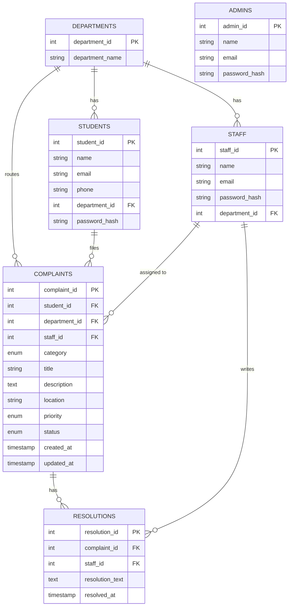

# Smart College Complaint & Resolution System — Architecture (Phase 1)

## Tech Stack
- **Frontend:** HTML5, CSS3, JavaScript, Bootstrap 5, Font Awesome, Chart.js
- **Backend:** Python + Flask
- **Database:** MySQL 8.0+ via `mysql-connector-python`
- **Auth:** Session-based, `werkzeug.security` password hashing (scrypt)

## Project Structure
```
SmartCollegeComplaint/
├── app.py                     # Flask app + all routes (Phase 2+)
├── database.py                # DB connection helper (Phase 2)
├── config.py                  # Config loaded from .env               ✅ created
├── requirements.txt           # Python dependencies                    ✅ created
├── .env.example                # Credential template                   ✅ created
├── README.md                  # Setup instructions (Phase 10)
├── database/
│   └── database.sql           # Full schema + seed data                ✅ created
├── templates/                 # Jinja2 HTML pages (Phase 4+)
└── static/
    ├── css/style.css
    ├── js/script.js
    └── images/
```

## Entity-Relationship Diagram



## Key Design Decisions
- **`admins` table** added (not in the original spec) so admin login is a real, separate authenticated role rather than a hardcoded check — needed for genuine role-based access control.
- **ENUMs** used for `category`, `priority`, `status` to enforce valid values at the database level.
- **ON DELETE rules:** complaints cascade-delete with their student (a student's data is fully removable); complaints keep existing if a department/staff row is deleted (`SET NULL`), so complaint history isn't destroyed by admin cleanup.
- **Indexes** on `status`, `priority`, `category` since these are the columns most filtered/grouped on for dashboards.
- Passwords are never stored in plain text — seed data uses placeholder hashes; `app.py` (Phase 2/3) will generate real ones with `werkzeug.security.generate_password_hash`.

## Roadmap
| Phase | Content | Status |
|---|---|---|
| 1 | Architecture + database.sql | ✅ done |
| 2 | Flask backend + DB connectivity | next |
| 3 | Authentication (student/admin/staff) | pending |
| 4 | Student-facing UI (landing, register, login, dashboard) | pending |
| 5 | Complaint CRUD | pending |
| 6 | Admin dashboard | pending |
| 7 | Staff + resolution management | pending |
| 8 | Charts + graphics + animations | pending |
| 9 | Testing + bug fixing | pending |
| 10 | README + report + PPT + viva prep | pending |
